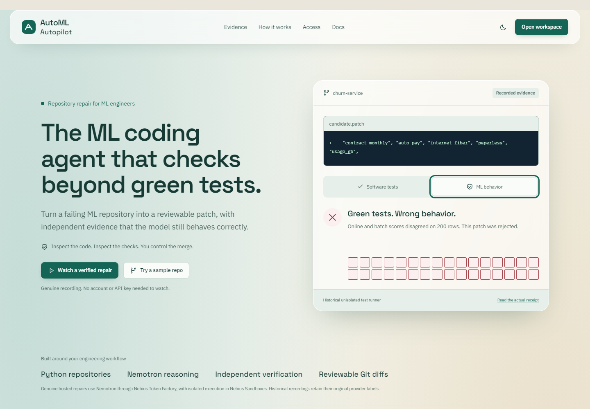
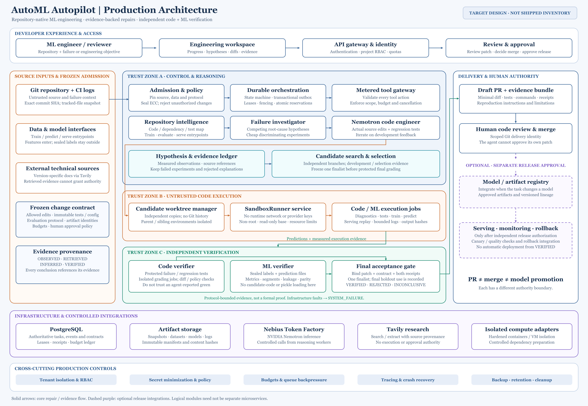
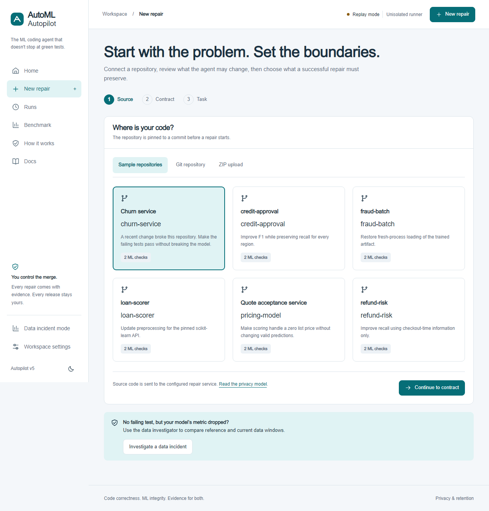
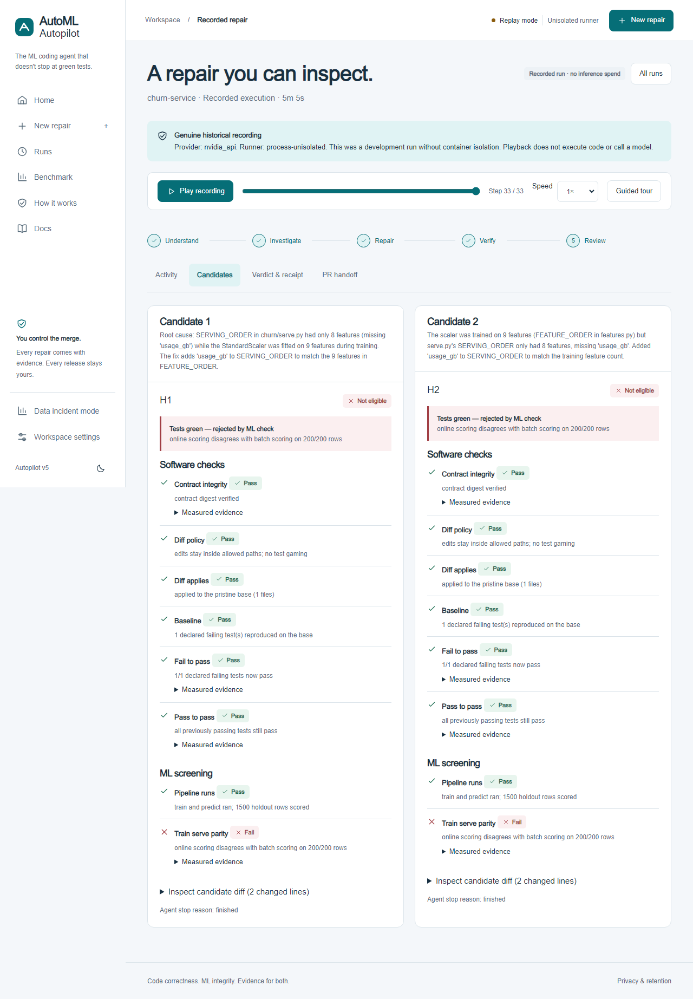

<p align="center">
  
</p>

<h1 align="center">AutoML Autopilot</h1>

<p align="center"><strong>The ML coding agent that checks beyond green tests.</strong></p>
<p align="center">A broken ML repository. A reviewable patch. Independent evidence for the code and the model.</p>

<p align="center">
  <a href="https://github.com/sankalp2515/AutoML-Autopilot/actions/workflows/ci.yml"></a>
  <a href="LICENSE"></a>
  <a href="backend/requirements-runtime.txt"></a>
  <a href="docs/NEBIUS_DEPLOYMENT_VALIDATION.md"></a>
  <a href="https://136-112-7-18.sslip.io/repair"></a>
</p>

<p align="center">
  <a href="https://136-112-7-18.sslip.io/repair"><strong>Try it live</strong></a> ·
  <a href="https://136-112-7-18.sslip.io/repair/replay/nebius_churn_verified">Watch a verified repair</a> ·
  <a href="#local-start">Quick start</a> ·
  <a href="#architecture">Architecture</a> ·
  <a href="#results-and-honest-limits">Evidence</a> ·
  <a href="docs/README.md">Documentation</a>
</p>

[](https://136-112-7-18.sslip.io/repair)

## Why AutoML Autopilot

AutoML Autopilot repairs Python ML repositories and produces a patch with independent software and ML verification. It is for engineers debugging broken serving code, preprocessing changes, leakage, serialization failures and quality regressions. Passing a test suite is useful evidence; it is not enough to prove a model still behaves correctly.

The agent investigates competing causes, writes source edits and regression tests in isolated candidate workspaces, and submits the result to a separate verifier. The reviewer sees the diff, checks, missing evidence and verdict before downloading a patch or requesting a draft PR. **Nothing merges automatically.**

| An engineer needs to know | The product exposes |
|---|---|
| What caused the failure? | Competing hypotheses, source references and diagnostic observations |
| What did the agent change? | Exact Git diff, added regression tests and recorded tool/terminal activity |
| Did it repair the software? | Reproduced baseline, fail-to-pass and pass-to-pass checks |
| Does the ML behavior still hold? | Declared checks for parity, leakage, quality and protected groups |
| Who approves delivery? | A patch or draft PR with independent receipts; the human controls the merge |

## See it in two minutes

1. Open the [hosted product](https://136-112-7-18.sslip.io/repair), or start the local stack below.
2. Choose **Watch a verified repair**. This is a labelled genuine recording, not a new inference call. No account or model key is required to watch.
3. Open the candidate diff, then **Verdict & receipt**. Inspect the code and ML checks, their recorded runtime and provenance.
4. Return to the landing page and inspect the rejected churn example. Software checks passed while the online/batch comparison failed. That historical recording used an unisolated test runner and says so.

The landing page also links authored leakage and protected-group checker proofs. These are reproducible validation cases, not customer testimonials or autonomous success-rate claims.

## Local start

Prerequisites: Python 3.12+, Docker CLI/Compose v2 and a running Linux Docker daemon. Internet is needed for first image/dependency downloads. Windows can use Docker Desktop with Linux containers.

```powershell
python scripts/v5_stack.py up --project automl-v5-local --port 3133
python scripts/v5_stack.py doctor --project automl-v5-local --port 3133
```

Open **http://localhost:3133/repair**. This starts eight services, initializes/migrates PostgreSQL, prepares a source-only sample catalog and mounts recorded evidence. No user `.env` is read or written. Internal generated credentials live in a private operator directory outside the checkout. Model keys are cleared and live inference is disabled by default.

Optional fixture warm-up and shutdown:

```powershell
python scripts/v5_stack.py warm --project automl-v5-local --port 3133
python scripts/v5_stack.py down --project automl-v5-local --port 3133
```

Shutdown preserves data volumes. Do not use `down -v` on a retained installation. Fresh-host setup time depends on registry/network speed; no under-ten-minute guarantee is claimed. See [operations](docs/V5_OPERATIONS.md) for credentials, backup/restore, least-privilege roles and remaining host requirements.

## Run a new repair

Live work is explicit, bounded and disabled unless enabled. An operator supplies provider credentials through a private process environment, configures invite access and starts with `--allow-live`. The [judge-only plan](docs/JUDGE_DEPLOYMENT_AND_COSTS.md) explains the $29.50 balance, lifetime allowance, cooldown, replay access and hosting choices. Do not paste credentials into issues, receipts or Git history.

In **New repair**, choose a sample, public repository URL or ZIP; review `autopilot.yaml`; select failing tests and ML requirements; optionally upload evaluation labels separately; then start. Six included repositories cover churn parity, loan preprocessing, refund leakage, credit group recall, fraud serialization and pricing numeric boundaries. Without labels, the product reports limited label-free evaluation rather than inventing predictive quality.

### A minimal contract

```yaml
version: 1
name: python-service
python: "3.12"
install: pip install -r requirements.txt
commands:
  test: python -m pytest -q tests
task:
  type: restore
  fail_to_pass:
    - tests/test_service.py::test_service
  ml_invariants: []
policy:
  allowed_edit_roots: [src/, tests/]
  immutable_existing_tests: true
```

This software-only example does **not** establish model quality. ML tasks also declare train/predict commands, data paths, serving/load entrypoints and the desired invariants. See the [six sample contracts](fixtures/repos) and in-app contract documentation at `/repair/docs`. Installs require exact top-level dependency pins and wheels from the operator-approved HTTPS index. Existing tests and protected files remain immutable; added regression tests are allowed by policy.

## Architecture

[](docs/assets/production-architecture.png)

*The supplied production target diagram, reproduced unchanged. Click to view at full resolution. Optional registry, serving, monitoring and rollback boxes describe the broader vision; they are not shipped v5 repair-delivery features. The [as-built architecture](docs/V5_ARCHITECTURE.md) distinguishes the deployed inventory and remaining integrations.*

### What is running, and where

- **Frontend and API:** Next.js workspace and FastAPI control plane; tenant-scoped tasks, contracts, packs, events and delivery.
- **Repair worker:** Nemotron hypothesis/planning and candidate generation; bounded calls, tools, source edits and checkpoints.
- **Execution boundary:** Nebius Sandboxes on the hosted demo; Docker CLI runner for local use. Network-disabled commands, immutable prepared images and independent workspaces.
- **Verifier:** separate authority for code/ML receipts, sealed data and a separate transactional PostgreSQL admission/holdout ledger.
- **Storage:** application PostgreSQL plus artifact/pack/verifier volumes. Backups and replay receipt hashes were checked in an empty-target restore drill.

**Nebius status:** Super and Nano have both completed genuine Token Factory calls. Hosted churn, loan and fraud repairs independently VERIFIED using the new Nebius Sandboxes adapter. Reports preserve provider, model, usage and immutable image UUID. [Validation, limits and cost controls](docs/NEBIUS_DEPLOYMENT_VALIDATION.md).

### Inside the workspace

| Investigate and inspect | Review and hand off |
|---|---|
| [](docs/assets/repair/source-six-repositories.png)<br>**Six repositories with explicit repair contracts** | [](docs/assets/repair/candidate-evidence.png)<br>**Source changes and evidence behind the verdict** |

Screenshots show the product interface. Genuine run outcomes and provider provenance are linked below; historical examples retain their original runtime labels.

## How Nemotron and Tavily are used

Nemotron proposes explanations and edits; it cannot issue the final trusted verdict. The hosted judge mapping uses Super for diagnosis and patching, with Nano configured for fast work. Both models were directly probed; a repair need not call every tier. The current client records actual provider/model/usage per call. Missing accounting stays unknown.

Tavily is conditional: relevant library/API failures trigger official-documentation retrieval. Sources and excerpts remain attributed external data. One matched current-engine B01 pair with Tavily enabled/disabled independently verified both patches; the enabled arm actually retrieved official documentation. That one pair demonstrates integration, not a general benefit estimate.

## Results and honest limits

The hosted integration was exercised through the public browser flow, from the landing page to terminal verdict. Six genuine attempts covered five distinct fixtures; churn was repeated after a runtime-label correction.

| Hosted fixture | Outcome | What the recorded result establishes |
|---|---|---|
| [Churn service](docs/benchmarks/repair/nebius-live/churn-service/report.json) | **VERIFIED** | Serving repair passed the admitted code and ML checks |
| [Loan scorer](docs/benchmarks/repair/nebius-live/loan-scorer/report.json) | **VERIFIED** | Preprocessing repair independently accepted |
| [Fraud batch](docs/benchmarks/repair/nebius-live/fraud-batch/report.json) | **VERIFIED** | Serialization repair independently accepted |
| [Refund risk](docs/benchmarks/repair/nebius-live/refund-risk/report.json) | **REJECTED** | Declared failing test remained broken; ML grading was not reached |
| [Credit approval](docs/benchmarks/repair/nebius-live/credit-approval/report.json) | **INCONCLUSIVE** | Invalid model tool actions produced no patch; no success claimed |

**$0.080805 estimated inference** across the six hosted attempts, plus the two tiny model probes. This small integration sample is not a benchmark success rate or a provider invoice guarantee. [Hosted UI ledger](docs/benchmarks/repair/nebius-ui-validation.json) · [Cloud recovery proof](docs/benchmarks/repair/nebius-cloud-restore.json)

| Evidence | What it establishes |
|---|---|
| Six fixture proof stories | Unpatched failure, an authored wrong-green rejection and reference acceptance under the declared protocol |
| Genuine hosted Nebius recordings | Specific code/ML verdicts using Token Factory and Nebius Sandboxes; small integration sample |
| Genuine NVIDIA recordings | Specific model-generated repair outcomes with provider/runtime provenance |
| Six planner measurements | Five precise leading mechanisms, one partial diagnosis; single seed, reference-aware manual review |
| Partial historical four-arm study | Six pilots and 15/72 comparison slots; insufficient for a comparative marketing headline |
| Local backend audit | 398 passing backend tests, two skips at commit 530fe9f; Docker boundary and restore evidence |

[Evidence artifacts](docs/benchmarks/repair) · [Backend audit](docs/BACKEND_OPERATIONS_AUDIT.md) · [Current backlog](docs/V5_BACKLOG_FINAL.md)

A VERIFIED receipt means the declared checks passed for the admitted snapshot, patch and evaluation data. It is not a guarantee over all future inputs. Legacy sealed tests importing candidate Python are unsupported in production; use the clean inert-artifact protocol. Arbitrary frameworks, multi-host sandbox routing, per-tenant disk quotas and production SLOs remain outside proven acceptance. The judge VM has an aggregate 20-GiB data filesystem. Nebius beta forbids personal/sensitive data; use public code and synthetic inputs for that demonstration.

## Develop and verify

```powershell
# Backend, from backend/
python -m pip install -r requirements-runtime.txt pytest pytest-asyncio
python -m pytest tests/test_autopilot tests/test_repair -q -m "not slow and not docker"
python -m pytest tests/test_repair/test_sandbox_local.py -q
python -m pytest tests/test_repair -q -m slow
# Frontend, from frontend/
npm ci --legacy-peer-deps
npx tsc --noEmit
npm run build
```

PostgreSQL tests require disposable URLs through `REPAIR_TEST_POSTGRES_URL` and `REPAIR_TEST_LEDGER_URL`; their tables are recreated. Never point them at application data. Browser verification and required checks are described in [CONTRIBUTING.md](CONTRIBUTING.md). Model calls are not required for the deterministic test suite.

## Earlier modes and license

The earlier data-incident mode remains reachable at `/autopilot`. The original dataset-to-model orchestrator source is retained for reproducibility and future extraction; it is not the v5 repair engine or a supported dependency of the hackathon product. See [legacy scope and maintenance policy](docs/LEGACY_SCOPE.md) and the [historical v4 README](docs/LEGACY_V4_README.md).

Repository code is licensed under [GNU GPL version 3](LICENSE). Existing third-party code/data retains its own notices; the pinned public MLOps subset includes upstream licenses and provenance under [fixtures/external](fixtures/external). NVIDIA models, Nebius and Tavily are separate services with their own terms. Their use does not imply endorsement, partnership or a hackathon award.

Bundled fonts retain their [SIL Open Font License notices](frontend/public/fonts/README.md).

## Repository guide

| Path | Purpose |
|---|---|
| [`backend/app/repair`](backend/app/repair) | Intake, policy tools, agent, runner adapters, independent grading and durable tasks |
| [`frontend`](frontend) | Landing page, engineering workspace, replay player and browser tests |
| [`fixtures`](fixtures) | Synthetic repair repositories, public patterns, proof inputs and upstream notices |
| [`scripts`](scripts) | Startup, backup/recovery, evaluation and cloud operations |
| [`deploy`](deploy) | Service images, database initialization and Google Cloud/Nebius deployment |
| [`docs`](docs/README.md) | Architecture, API, operations, evidence, backlog and submission notes |

[Documentation index](docs/README.md) · [Changelog](CHANGELOG.md) · [Contributing](CONTRIBUTING.md) · [Support](SUPPORT.md) · [Security](SECURITY.md)
