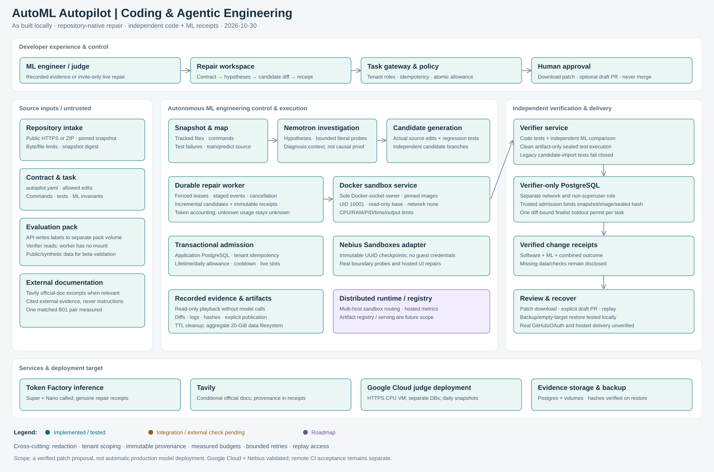

# v5 architecture: as built and deployment target

The diagram preserves the target's developer-control row, source/control/delivery columns, infrastructure row and cross-cutting controls. Teal means implemented and locally tested; amber means integration or external verification remains; violet means roadmap. Read status per box, not as an assertion of cloud deployment.

## Runtime boundaries

| Zone | Owns | Must not own |
|---|---|---|
| Browser / Next.js | Workspace UX, replay playback, review controls | Model keys, sealed labels, trusted verdict authority |
| API | Tenant permissions, intake, contract, global admission, trusted verifier registration | Model calls, candidate execution or candidate-authored verdicts |
| Repair worker | Hypotheses, tools, source changes, bounded provider calls, fenced checkpoints | Holdout labels, admission token, trusted evaluation capability, Docker socket |
| Sandbox service | Candidate environments and Docker daemon capability | Provider keys and verifier packs |
| Independent verifier | Sealed bundles/packs, clean artifact test evaluator, code/ML receipts | Provider keys; agent control over final verdict |
| Verifier PostgreSQL | Durable admission and single-finalist holdout permit | Worker/API database access |

The application PostgreSQL persists tasks/events/candidates/receipts/worker heartbeats and atomic admission commitments. A separate verifier database binds the original ECC, snapshot bytes, immutable dependency image and sealed bundle. A changed diff cannot reuse the same logical candidate permit. Reproducible caches expire; verifier admissions and holdout permits do not.

Candidate commands run in separate Docker containers with no network, non-root UID, read-only base, bounded tmpfs/CPU/RAM/PIDs/time/output, and only their own work/output mounts. Approved exact-pin wheel installation happens during prepare. Execution uses an immutable dependency image. The host Docker daemon and base/dependency image remain trusted. This is not a kernel-exploit guarantee.

Supported sealed artifact tests import no candidate Python; they see inert allowlisted exports in a clean independent environment. Legacy candidate-import tests remain unsupported/fail-closed. ML verification compares raw observations outside candidate authority. Tool denials and unavailable checks remain evidence rather than becoming passes.

## Deployment target after local acceptance

A Google Cloud CPU VM may host Next.js, FastAPI, worker/verifier services, both PostgreSQL stores and artifact volumes. Nemotron runs through Nebius Token Factory; generated code runs in Nebius Sandboxes after the adapter is implemented. This keeps hosting provider-independent while using the required Nebius model/execution services. The current `RemoteRunner` speaks our internal sandbox API, not Nebius's service; a direct adapter is still required.

The external runtime adapter must map immutable image UUIDs, upload/download, branch state, cancellation, output bounds, no-network execution and clean trusted evaluation into the frozen runner capabilities. It must pass the same boundary proofs. Never pass a Nebius key or sealed labels to candidate execution. Inspect account-effective storage limits; moving execution does not fix API upload/clone disk quotas.

As an interim local/deployment topology, the tested eight-service Compose stack uses the Docker runner. Replacing execution does not require removing the independent verifier or its separate ledger. Explicit trusted capabilities remain separate even if two roles use the same external sandbox service.

## Scope and scaling limits

Built: one sandbox owner/node, transactional shared PostgreSQL admission/fencing, two-candidate repair, durable evidence, read-only replay and restore drill. Not established: host hard disk quotas, transparent multi-host sandbox routing, arbitrary framework compatibility, external OAuth/GitHub delivery, real Nebius inference/execution, production SLOs, hosted alerts, or cloud restore. Model registry/serving/canary/automatic rollback in the larger vision are not v5 repair delivery features. A verified patch ends at human review.

See [operations](V5_OPERATIONS.md), [judge budget and deployment](JUDGE_DEPLOYMENT_AND_COSTS.md), [API](API_V5.md) and [legacy scope](LEGACY_SCOPE.md).
